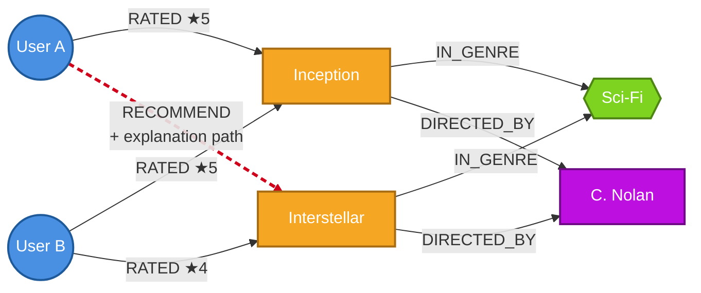

# Knowledge Graphs — A New Lens for Analytics

*Slide for the Analytics CoE — paste sections into Google Slides as needed.*

---

## Title (suggested)

**Knowledge Graphs: From Black-Box Predictions to Glass-Box Insights**

---

## 1. The Problem

Analytics data lives in **silos** — warehouses, lakes, document stores, vector DBs. The **relationships** between customers, products, behaviors, and content are buried in foreign keys or lost across systems.

- Joins answer narrow questions; **multi-step reasoning** is expensive or impossible
- ML models produce predictions but rarely the **reasoning behind them**
- Stakeholders (and regulators) increasingly demand **"why was this recommended?"**

---

## 2. What Knowledge Graphs Solve

A Knowledge Graph represents data as **entities (nodes)** and **explicit, typed relationships (edges)** — a queryable, schema-light semantic layer over your data.

- **Multi-hop reasoning** across heterogeneous sources in a single query
- **Explainability by design** — every result carries the path of facts that produced it
- Foundation for **GraphRAG** (LLM grounding), **fraud-ring detection**, **Customer 360**, and **semantic search**

---

## 3. What We Are Building

An end-to-end **KG-powered Movie Recommender** on MovieLens 100K + TMDB enrichment:

- **Neo4j AuraDB** graph — 7 node labels, 6 relationship types
- **Streamlit UI** with hybrid recommendations powered by graph traversal (collaborative + content-based)
- Every recommendation surfaces its **explanation path** — the exact chain of nodes and edges that produced it

> *Tagline:* "From black-box predictions to glass-box recommendations."

---

## Mermaid diagram — render & paste as image

> **How to render:** open <https://mermaid.live>, paste the block below, then **Export → PNG (or SVG)** and drop into the Google Slide. *(Same dance works in mermaid.ink, mermaidchart.com, or any Mermaid-aware editor.)*

**What the diagram shows (1-line caption for the slide):**
*User A is recommended "Interstellar" because a similar user (B) liked it — and the movie shares both genre and director with one User A already rated. The dotted red edge is the recommendation; the solid edges are the explanation.*

---

## Speaker notes (optional, ~30s)

> Traditional recommenders give you a movie and a confidence score — that's it. With a Knowledge Graph, the system can also hand you the **reasoning path**: "User B liked the same movie you did, both films share genre and director — here's why." This makes recommendations **auditable, debuggable, and trustworthy** — and the same pattern extends well beyond movies: fraud rings, churn drivers, customer journeys, GraphRAG for LLMs.
