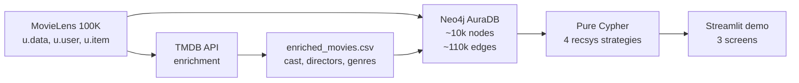

# Course Overview — KG-Based Recommendation System

The front door. Read this first.

> **Reading time:** ~30 minutes
> **How to use this doc:** read it end-to-end the first time, then keep it open as a map. Sections 4 and 6 are the parts you'll come back to when you wonder *"which module covers X?"* or *"what should I open next?"*.

---

## 1. What this project is

An end-to-end Knowledge Graph recommendation system, built as a **self-paced course on Knowledge Graphs** for Data Analysts, ML Engineers, and Data Engineers.

It uses the MovieLens 100K dataset, enriches it with TMDB metadata, loads it into Neo4j AuraDB, and serves four recommendation strategies — all written in **pure Cypher** with an **explainability path** on every result. A Streamlit demo wraps it for interactive use.

The goal isn't a production recsys. It's to teach what a Knowledge Graph buys you over tabular/SQL approaches, by building one end-to-end.

---

## 2. Why a Knowledge Graph?

### 2.1 The relational problem

Tables are excellent at:
- Storing tabular data (rows × columns)
- Aggregations along a single dimension (`SUM`, `AVG`, `GROUP BY`)
- Single-entity lookups (`SELECT * FROM users WHERE id = 196`)

Tables become awkward when the question is about **traversals across many entity types**:
- "What movies did directors of movies user 196 rated highly *also* direct?" — 3 hops.
- "Which actors collaborated with co-stars of the lead actor in user 196's favorite movie?" — 4 hops.

Every hop is another `JOIN`. Every entity type is another table. Schemas grow, queries grow, your mental model of what each alias represents starts breaking down at the 4th join.

There's also a hidden cost: **explainability**. When a tabular recsys recommends a movie, the "why" lives inside the score computation, often outside the query itself. Reproducing the *reason* requires a separate trace.

### 2.2 What a KG buys you

**Multi-hop queries collapse to a pattern.**
A 7-JOIN SQL chain becomes a single Cypher pattern: `(user)-[:RATED]->(movie)-[:DIRECTED_BY]->(director)<-[:DIRECTED_BY]-(other_movie)`. The pattern *reads like the question*.

**Explainability is built in.**
The path that produced the result *is* the explanation. "We recommend *The Prestige* because you rated *Inception* 5★ → Nolan directed *Inception* → Nolan directed *The Prestige*." Every arrow is a Cypher relationship — traceable, displayable, defensible.

**Cold-start handles gracefully.**
A new user with one rating can still get recommendations via demographic pivots:
`(new_user)-[:HAS_OCCUPATION]->(occ)<-[:HAS_OCCUPATION]-(peer)-[:RATED]->(movie)`.
The same query handles cold start *and* warm users — no separate codepath.

**Schema evolution is cheap.**
Adding a new relationship type (e.g. `:TAGGED_WITH`) doesn't require `ALTER TABLE` or migration scripts. You `MERGE` the new edges onto existing nodes, and queries that don't use the new edge continue to work unchanged.

### 2.3 One concrete contrast

The question: *"Find movies that feature actors from films directed by the directors of movies user 196 rated highly."*

That's 4 hops: user → movie → director → other movie → actor → target movie.

**SQL** (against a normalized schema):

```sql
SELECT DISTINCT m_target.title
FROM ratings r196
  JOIN movies m_seed       ON r196.movie_id = m_seed.movie_id
  JOIN movie_directors md1 ON m_seed.movie_id = md1.movie_id
  JOIN movie_directors md2 ON md1.director_id = md2.director_id
  JOIN movies m_other      ON md2.movie_id = m_other.movie_id
  JOIN movie_actors ma1    ON m_other.movie_id = ma1.movie_id
  JOIN movie_actors ma2    ON ma1.actor_id = ma2.actor_id
  JOIN movies m_target     ON ma2.movie_id = m_target.movie_id
WHERE r196.user_id = 196
  AND r196.rating >= 4
  AND m_target.movie_id NOT IN (m_seed.movie_id, m_other.movie_id);
```

**Cypher**:

```cypher
MATCH (u:User {userId: 196})-[r:RATED]->(seed:Movie),
      (seed)-[:DIRECTED_BY]->(d:Director)<-[:DIRECTED_BY]-(other:Movie),
      (other)-[:FEATURES_ACTOR]->(a:Actor)<-[:FEATURES_ACTOR]-(target:Movie)
WHERE r.rating >= 4
  AND target <> seed AND target <> other
RETURN DISTINCT target.title
LIMIT 10;
```

13 lines vs 7. Eight joins to track in your head vs one MATCH pattern that reads like the original question. The Cypher *is* the question.

For the full SQL-vs-Cypher treatment — six paired examples on a real loaded graph — see [notebook 10](../notebooks/10_sql_vs_cypher.ipynb).

### 2.4 When NOT to use a KG

Honesty check: a KG isn't always the right answer.

- **Pure aggregations** — counting rows, summing columns, `GROUP BY` a single dimension. SQL is faster, simpler, and more familiar.
- **OLAP / star-schema workloads** — data warehouse patterns are tuned for tabular, columnar storage. KGs don't win here.
- **Single-entity reads** — "give me user 196's profile" is `SELECT * FROM users`. Adding a KG adds friction with no payoff.
- **Small data with shallow relationships** — setup overhead doesn't amortize.
- **Strong relational guarantees (OLTP)** — most graph DBs trade ACID strictness for traversal speed.

The KG win is **multi-hop traversal + explainability**. If neither matters for your problem, stay with tables.

---

## 3. Project architecture

### 3.1 The pipeline



The ratings, users, and demographics flow straight from MovieLens into the graph. The TMDB enrichment fills in what MovieLens lacks: cast (with billing order), directors, and richer genre data. Both meet inside AuraDB, where four recommendation strategies — all pure Cypher — power a Streamlit demo.

### 3.2 The schema (overview)

**7 node labels, 6 relationship types.** Full specification and design rationale live in [notebook 03](../notebooks/03_graph_schema.ipynb); the color-coded diagram is in [docs/03](03_schema_diagram.md).

```
(:User {userId, age})-[:RATED {rating, timestamp}]->(:Movie {movieId, title, year, tmdbId})
(:User)-[:HAS_OCCUPATION]->(:Occupation {name})
(:User)-[:HAS_GENDER]->(:Gender {name})
(:Movie)-[:IN_GENRE]->(:Genre {name})
(:Movie)-[:DIRECTED_BY]->(:Director {name})
(:Movie)-[:FEATURES_ACTOR {billing_order}]->(:Actor {name})
(:Actor)-[:COLLABORATED_WITH {movie_count}]->(:Actor)   # derived
```

`:COLLABORATED_WITH` is **derived** — computed once from shared `:FEATURES_ACTOR` edges and written back as a materialized edge so the most expensive multi-hop strategies (2 and 3) stay fast.

### 3.3 The demo app

A Streamlit app with three screens:

- **User Profile** — pick a user; see what they've rated and a depth-1 neighborhood of their graph
- **Recommendation Engine** — pick a strategy + user; get top-N recommendations with the explainability path on each
- **Graph Explorer** — type any movie or actor; render a local subgraph around it with `pyvis`

Every recommendation shows the path that produced it. No black-box scores.

---

## 4. Course structure

**6 modules, ~15-20 hours total**, designed for self-paced study over **2-3 weeks at 5-7 hours/week**. You can stretch or compress; modules are gated on prerequisites, not calendar.

| Module | Artifacts | Time | What you'll be able to do |
|---|---|---|---|
| 1. Setup | docs/01 | ~60 min | AuraDB running, graph loaded, demo working |
| 2. Schema + data | notebooks 01, 02 (opt), 03; docs 02-03 | 2-3 hrs | Read a KG schema; explain why each edge exists |
| 3. Loading the graph | notebooks 04-08; docs 04-08 | 1-2 hrs | Write idempotent `MERGE` loaders; verify integrity |
| 4. Querying with Cypher | notebooks 09-10; docs 09-10 | 3-4 hrs | Write multi-hop Cypher; explain SQL trade-offs |
| 5. Recommendation strategies | notebooks 11-14; docs 11-15 | 4-5 hrs | Build 4 pure-Cypher strategies with explainability |
| 6. The demo app | `app/streamlit_app.py`; docs 16-19 | ~1 hr | Wire Streamlit to live Cypher with caching + error handling |

Module-by-module:

### Module 1 — Setup (~60 min)

Get to a working state: AuraDB instance live, Python env ready, graph loaded, Streamlit demo running. **Reference:** [docs/01_setup.md](01_setup.md).

> **Try this before you start:** predict how long setup will take *you* — write the number down. Compare to actual at the end. That's your "infrastructure tax" baseline for cloud-graph projects; useful when you scope future ones.

### Module 2 — Schema and data (2-3 hrs)

How the data looks raw, how it was enriched, and how it became a graph.

- [notebook 01 (EDA)](../notebooks/01_eda.ipynb) — explore raw MovieLens 100K
- [notebook 02 (TMDB enrichment)](../notebooks/02_tmdb_enrichment.ipynb) — *optional*, only if API patterns interest you (data is pre-enriched in the repo)
- [notebook 03 (schema design)](../notebooks/03_graph_schema.ipynb) — competency questions → node/edge choices → constraints
- [docs/02](02_enrichment_approach.md), [docs/03](03_schema_diagram.md) — design rationale and the visual schema

> **Try this:** before opening notebook 03, sketch your own schema for MovieLens on paper. Which entities become nodes? Which relationships do you split into their own type vs. fold into a property? Then compare to the locked schema. Every disagreement is a teaching moment — was the locked choice wrong, or did you miss a constraint?

### Module 3 — Loading the graph (1-2 hrs)

How nodes and edges become live data in AuraDB; how to verify the load.

- [notebooks 04-07](../notebooks/04_load_nodes.ipynb) — load nodes, movie-side edges, user-side edges, derived `:COLLABORATED_WITH`
- [notebook 08 (verification)](../notebooks/08_verification.ipynb) — five integrity checks
- [docs/04-08](04_load_nodes.md) — scope decisions per loader

> **Try this:** run [notebook 04](../notebooks/04_load_nodes.ipynb) once. Then immediately re-run every cell. The counts shouldn't change — that's idempotent `MERGE` in action. Now (don't save) change one `MERGE` to `CREATE` and re-run. The error you get is exactly why every loader uses `MERGE`.

### Module 4 — Querying with Cypher (3-4 hrs)

The meat of the language. Patterns, multi-hop traversal, and how SQL stacks up.

- [notebook 09 (Cypher 101)](../notebooks/09_cypher_queries.ipynb) — `MATCH`, `WHERE`, `RETURN`, `WITH`, multi-hop on recurring anchors (Toy Story, Tom Hanks, user 196, Comedy)
- [notebook 10 (SQL vs Cypher)](../notebooks/10_sql_vs_cypher.ipynb) — six paired examples on the same loaded data
- [docs/09-10](09_cypher_queries.md) — scope decisions on the chosen anchors and pairings

> **Try this:** before running [notebook 09](../notebooks/09_cypher_queries.ipynb) cell 5 (the multi-hop traversal from Tom Hanks to genres), write down 3 genres you expect to see. Run the cell. How many of your guesses appeared? The misses tell you where your mental model of MovieLens 100K is fuzzy — go check the actual ratings distribution before continuing.

### Module 5 — Recommendation strategies (4-5 hrs)

The heart of the course. Four strategies, all pure Cypher, all with explainability paths.

- [notebook 11 (genre affinity)](../notebooks/11_strategy_genre_affinity.ipynb) — single-hop baseline
- [notebook 12 (director / actor)](../notebooks/12_strategy_director_actor.ipynb) — multi-hop traversal
- [notebook 13 (collaborative filtering)](../notebooks/13_strategy_collaborative_filtering.ipynb) — shared-neighborhood peers
- [notebook 14 (composite multi-signal)](../notebooks/14_strategy_composite_multi_signal.ipynb) — weighted RRF of strategies 1-3
- [docs/11-15](11_strategy_genre_affinity.md) — scope decisions per strategy; [docs/15](15_unified_interface.md) covers the unified `get_recommendations()` entry point

> **Try this:** for user 196, run Strategy 1 (genre affinity) and Strategy 3 (collaborative filtering). Pick one movie that appears in *both* lists. Now read the explainability path each strategy returns for that movie — same recommendation, very different "why." That dual-justification is the value an explainability path delivers that a single recommendation score can't.

### Module 6 — The demo app (~1 hr)

Wire all the above into a UI. Streamlit + pyvis, three screens, live Cypher.

- [`app/streamlit_app.py`](../app/streamlit_app.py) — the implementation
- [docs/16-19](16_streamlit_user_profile.md) — per-screen design and debugging references

> **Try this:** launch the app, go to the Graph Explorer screen, search `toy story`, render the subgraph. Now trace one actor edge with your eyes — could you have predicted this exact local network from reading notebook 03's schema alone? The visualization makes data *shape* visible in a way Cypher text doesn't. Worth doing twice with different entry points.

---

## 5. How to learn from this material

This is self-paced — you set the cadence. A few practices make every module hit harder:

**Predict before you run.**
Every Cypher cell in every notebook is an opportunity to predict the output first. Even a rough prediction calibrates your mental model. Write it on a scratch pad — it doesn't have to live in the notebook.

**Modify and observe.**
When a notebook ships a working Cypher query, change one thing and re-run. Change a `LIMIT`. Swap a relationship type. Add a `WHERE` clause. The notebook teaches the "right answer"; the modifications teach the underlying behavior.

**Use both reading paths.**
The notebooks are the **primary teaching artifact** — they walk Cypher phase by phase. The numbered docs (03-19) are **scope decision logs** — they tell you *why* each design choice was made. Notebooks teach *how*; docs explain *why*. Read them together when the why matters.

**When you're stuck, query the graph.**
If a Cypher result surprises you, check the data directly:

```cypher
MATCH (m:Movie {title: "Toy Story (1995)"}) RETURN m;
```

The graph itself is the source of truth. Trust what you observe over what you remember.

**Skip what's obvious; revisit what's not.**
A senior data engineer probably doesn't need Module 1's Python tutorial sections — skim. A learner new to graph databases will want to slow down on Module 4. Modules are gated by *prerequisites*, not by hours.

---

## 6. Where to start

- **Brand new?** → [docs/01_setup.md](01_setup.md) — get AuraDB running and the graph loaded (~60 min)
- **Setup already done?** → [notebook 01](../notebooks/01_eda.ipynb) — start Module 2
- **Want to play with the demo first?** → after setup, run `streamlit run app/streamlit_app.py`
- **Want the schema first?** → [notebook 03](../notebooks/03_graph_schema.ipynb)
- **Looking for a specific topic?** → see the documentation table in the [README](../README.md)

Have fun. The graph is small enough to feel, and rich enough to teach.
