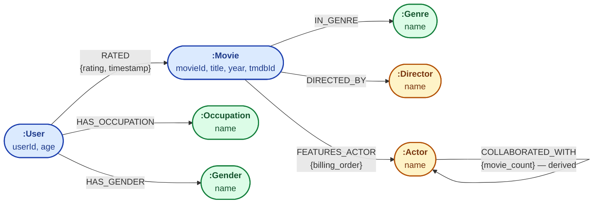

# Knowledge Graph Schema — Visual Reference

Visual reference for the KG schema defined in [`notebooks/03_graph_schema.ipynb`](../notebooks/03_graph_schema.ipynb).

This diagram shows all node labels, relationship types, and the properties carried by each. Renders natively on GitHub.

---

## Schema Diagram

---

## Legend

| Node group | Color | Labels | Description |
|---|---|---|---|
| **Entity** | Blue | `User`, `Movie` | Primary entities with unique numeric IDs from the source datasets. |
| **Person** | Amber | `Director`, `Actor` | Real-world people, identified by `name`. |
| **Categorical** | Green | `Genre`, `Occupation`, `Gender` | Low-cardinality reference nodes, identified by `name`. |

---

## Properties at a Glance

### Node properties

| Node | Properties | Key |
|---|---|---|
| `User` | `userId`, `age` | `userId` |
| `Movie` | `movieId`, `title`, `year`, `tmdbId` | `movieId` |
| `Genre` | `name` | `name` |
| `Director` | `name` | `name` |
| `Actor` | `name` | `name` |
| `Occupation` | `name` | `name` |
| `Gender` | `name` | `name` |

### Relationship properties

| Relationship | Properties | Direction |
|---|---|---|
| `RATED` | `rating` (1-5), `timestamp` (Unix epoch) | `User → Movie` |
| `IN_GENRE` | — | `Movie → Genre` |
| `DIRECTED_BY` | — | `Movie → Director` |
| `FEATURES_ACTOR` | `billing_order` (1-10) | `Movie → Actor` |
| `HAS_OCCUPATION` | — | `User → Occupation` |
| `HAS_GENDER` | — | `User → Gender` |
| `COLLABORATED_WITH` | `movie_count` (≥1) | `Actor → Actor` (derived; canonical single direction) |

---

## Schema Artifacts

Constraints and indexes applied at schema setup time (notebook 03, before any data load).

### Uniqueness constraints (auto-indexed)

| Constraint | Label | Key |
|---|---|---|
| `user_id` | `:User` | `userId` |
| `movie_id` | `:Movie` | `movieId` |
| `genre_name` | `:Genre` | `name` |
| `director_name` | `:Director` | `name` |
| `actor_name` | `:Actor` | `name` |
| `occupation_name` | `:Occupation` | `name` |
| `gender_name` | `:Gender` | `name` |

Each constraint auto-creates a backing index — endpoint lookups like `MATCH (a:Actor {name: "Tom Hanks"})` are index-hits, not scans.

### Query-time indexes

| Index | Type | Target | Use case |
|---|---|---|---|
| `movie_title_search` | FULLTEXT | `:Movie(title)` | CQ-4.5 — partial / tokenized title search (e.g. Streamlit search box) |

Fulltext (Lucene-backed) was chosen over a B-tree because the title use case is *substring/tokenized* matching, not equality — see [`notebooks/03_graph_schema.ipynb`](../notebooks/03_graph_schema.ipynb) §6 for the recorded decision.

### T-13 audit trail

T-13 ("Create uniqueness constraints + indexes on frequently queried properties") was satisfied by the T-09 schema design above — constraints and the title fulltext index live in [`notebooks/03_graph_schema.ipynb`](../notebooks/03_graph_schema.ipynb) §6 alongside the rest of the schema declarations, rather than as a separate T-13 notebook. T-14 (verification, see [`notebooks/08_verification.ipynb`](../notebooks/08_verification.ipynb)) re-confirms their presence at runtime via `SHOW CONSTRAINTS` / `SHOW INDEXES`.

---

## Cardinality Notes

- A `Movie` typically has **1-3 `IN_GENRE` edges**, **1-2 `DIRECTED_BY` edges**, and **up to 10 `FEATURES_ACTOR` edges** (capped at top 10 by billing order).
- A `User` has **exactly 1 `HAS_OCCUPATION` edge** and **exactly 1 `HAS_GENDER` edge**.
- A `User` has on average **~106 `RATED` edges** (100,000 ratings / 943 users).
- `:COLLABORATED_WITH` is **derived** from `:FEATURES_ACTOR` (not loaded from a source file). One canonical edge per actor pair, with `movie_count` reflecting shared movies (current data: 70,139 edges total; most pairs `movie_count = 1`, top is the *Star Trek* cast at 7). Prolific actors become super-hubs.
- The graph is **directed** at the storage level, but recommendation and explanation queries traverse it **undirected** (see notebook for the convention).

For the full design rationale, query conventions, and source mapping, see [`notebooks/03_graph_schema.ipynb`](../notebooks/03_graph_schema.ipynb).
